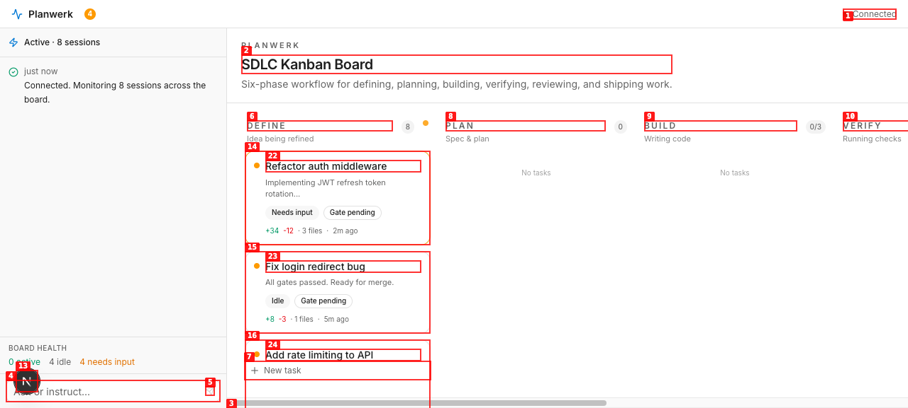
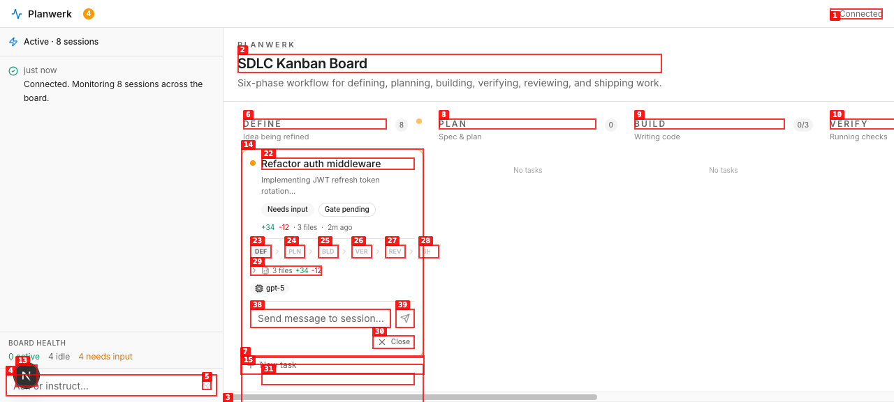
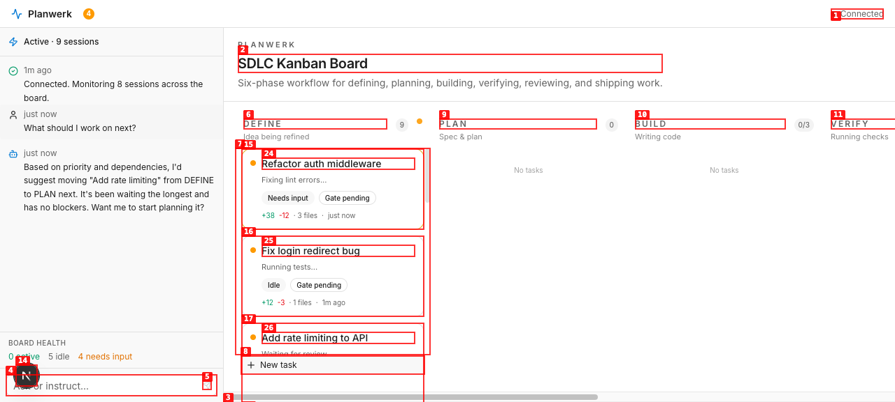
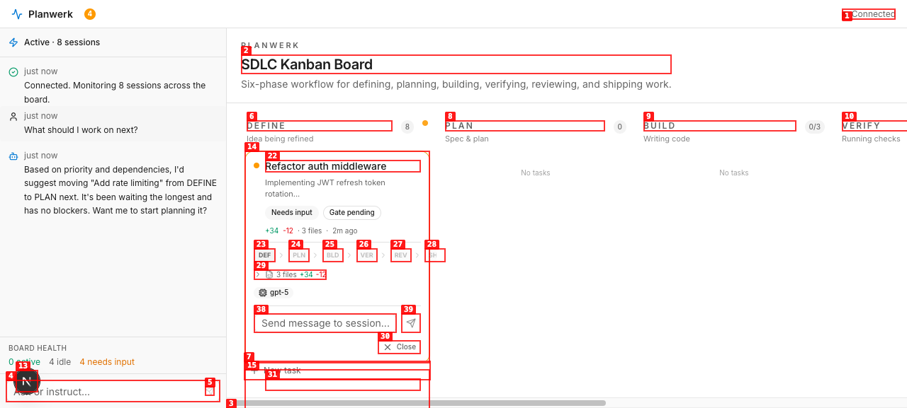

# Dogfood Report: Planwerk

| Field | Value |
|-------|-------|
| **Date** | 2026-06-15 |
| **App URL** | http://localhost:3000 |
| **Session** | planwerk |
| **Scope** | Full app — onboarding, board, orchestrator, card interaction |

## Summary

| Severity | Count |
|----------|-------|
| Critical | 0 |
| High | 1 |
| Medium | 3 |
| Low | 2 |
| **Total** | **6** |

## Issues

### ISSUE-001: All sessions land in DEFINE column — no phase distribution

| Field | Value |
|-------|-------|
| **Severity** | high |
| **Category** | ux |
| **URL** | http://localhost:3000 |
| **Repro Video** | {path to video, or N/A for static issues} |

**Description**

When entering Demo mode, all 8 mock sessions are placed into the DEFINE column because `mapSessionToCard()` defaults `phase` to "define" for all sessions. The PLAN, BUILD, VERIFY, REVIEW, and SHIP columns are all empty ("No tasks"). This makes the board look non-functional and doesn't showcase the SDLC flow at all.

**Expected:** Mock data should distribute sessions across multiple phases to show a realistic board state.

**Screenshot**

**Repro Video:** N/A (static issue on load)

---

### ISSUE-002: "SDLC Kanban Board" heading is redundant

| Field | Value |
|-------|-------|
| **Severity** | low |
| **Category** | ux |
| **URL** | http://localhost:3000 |

**Description**

The main area has a large "SDLC Kanban Board" heading with subtitle "Six-phase workflow for defining, planning, building, verifying, reviewing, and shipping work." This wastes valuable vertical space. The title bar already says "Planwerk" and the columns themselves are self-explanatory. For a desktop-grade app, this space should be used for the board.

**Screenshot**

**Repro Video:** N/A

---

### ISSUE-003: Gate pipeline shows raw card IDs as tooltip content

| Field | Value |
|-------|-------|
| **Severity** | medium |
| **Category** | ux |
| **URL** | http://localhost:3000 |

**Description**

When a card is expanded, the gate pipeline steps show tooltip content like "ahp-session:/session-1-define-gate" which is the internal resource ID. These should show phase names or gate descriptions.

**Screenshot**

**Repro Video:** N/A

---

### ISSUE-004: Cards show "Needs input" and "Gate pending" badges taking too much horizontal space

| Field | Value |
|-------|-------|
| **Severity** | medium |
| **Category** | ux |
| **URL** | http://localhost:3000 |

**Description**

Each card shows "Needs input" and "Gate pending" as full-text badges. In the narrow 280px column, these take up significant space and don't provide enough differentiation. At a glance, every card looks the same — all amber dots, all "Gate pending". The runtime status badge should be more compact (icon-only or colored dot) and the gate pending badge adds no value when ALL cards are pending.

**Screenshot**

**Repro Video:** N/A

---

### ISSUE-005: Board health shows "0 active" even though mock SSE shows sessions running

| Field | Value |
|-------|-------|
| **Severity** | medium |
| **Category** | functional |
| **URL** | http://localhost:3000 |

**Description**

The health bar says "0 active" but sessions are being tracked as "Needs input" (which maps to input-needed runtime). The SSE mock sends InProgress status (8) for some sessions, but after mapping and SSE updates, the runtime status appears to fluctuate. The health bar should reflect what the board shows.

**Screenshot**

**Repro Video:** N/A

---

### ISSUE-006: Orchestrator response disappeared from initial view

| Field | Value |
|-------|-------|
| **Severity** | low |
| **Category** | ux |
| **URL** | http://localhost:3000 |

**Description**

After asking "What should I work on next?", the orchestrator's response is visible. However, using `flex-col-reverse` for the feed means the connected message at the top appears at the *bottom* of the container, and as more items are added, older items scroll UP out of view. The UX works for chat but the "Connected. Monitoring 8 sessions" message should perhaps be pinned or styled differently since it's a system status, not a chat message.

**Screenshot**

**Repro Video:** N/A

---
